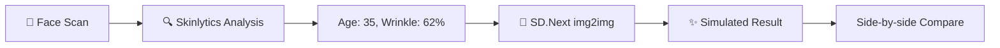

# 🧠 Brainstorm: Skinlytics AgeVision AI × SD.Next Integration

## Understanding the Two Projects

### Your Project: **Skinlytics AgeVision AI**
| Aspect | Details |
|---|---|
| **Stack** | Next.js 16, TensorFlow.js, face-api.js, Tailwind, Shadcn/UI |
| **Core Features** | Real-time face detection, age estimation, wrinkle scoring (Sobel edge detection), skin clarity analysis |
| **Architecture** | Client-first PWA — all ML inference runs in-browser |
| **Language** | Bahasa Indonesia UI with localized skin insights |
| **Privacy** | Zero server-side image processing (privacy-first) |

### SD.Next (vladmandic/sdnext)
| Aspect | Details |
|---|---|
| **What it is** | All-in-one WebUI for AI generative image/video creation powered by Stable Diffusion |
| **Key Capabilities** | txt2img, img2img, ControlNet, inpainting, outpainting, image captioning, FaceID, IP Adapters, upscaling, video generation |
| **API** | Full REST API at `/sdapi/v1/*` — txt2img, img2img, control, detect, interrogate, upscale, etc. |
| **Models** | SD 1.5, SDXL, SD3, FLUX, HiDream, LTX Video, and dozens more |
| **Platform** | Python-based server (CUDA, ROCm, Intel, Apple MPS, Docker) |

---

## 💡 The Big Idea: Why Combine Them?

Your Skinlytics app **analyzes** skin. SD.Next **generates** images. Together, you can build something no one else has:

> **A platform that analyzes your real skin condition and then uses generative AI to show you realistic simulations of how your skin could look — younger, older, with or without treatments.**

This creates a feedback loop: **Analyze → Visualize → Recommend → Motivate**

---

## 🚀 6 Integration Concepts (Ranked by Impact)

### 1. 🪞 AI Skincare Treatment Simulator ⭐ TOP PICK
**"See your skin after 6 months of treatment"**



**How it works:**
1. User scans face → Skinlytics detects age=35, wrinkle_score=62%
2. App constructs a prompt like: *"same person, clearer skin, reduced forehead wrinkles, healthy glow, moisturized skin, professional portrait"*
3. Sends face image + prompt to SD.Next `img2img` API with ControlNet (to preserve facial identity)
4. User sees **before/after** comparison
5. Optionally show progressive improvement: 1 month, 3 months, 6 months

**SD.Next APIs used:**
- `/sdapi/v1/img2img` — transform the face image
- `/sdapi/v1/control` — ControlNet to maintain facial identity (FaceID/IP Adapter)
- `/sdapi/v1/upscale` — high-res output

**Why it's powerful:** Beauty clinics would PAY for this. It's the #1 consultation tool they lack.

---

### 2. 🏥 Virtual Dermatology Clinic Dashboard
**"AI-powered skin consultation with visual evidence"**

Instead of just showing numbers (age: 35, wrinkle: 62%), generate a **clinical-grade visual report**:

| Feature | Implementation |
|---|---|
| **Skin Heatmap** | Use SD.Next inpainting to overlay colored zones on wrinkle regions |
| **Texture Enhancement** | Upscale facial regions to show micro-texture details |
| **Problem Area Highlights** | Generate annotated versions of the face highlighting crow's feet, forehead lines, nasolabial folds |
| **Treatment Comparison** | Side-by-side of "current" vs "ideal for age group" |

**New database schema extension:**
```sql
-- Add to your existing results table
ALTER TABLE results ADD COLUMN generated_image_url TEXT;
ALTER TABLE results ADD COLUMN simulation_prompt TEXT;
ALTER TABLE results ADD COLUMN simulation_params JSONB;
```

---

### 3. ⏳ Skin Aging Time-Lapse Generator
**"See yourself at 25, 35, 45, 55, 65"**

```
User Photo → [SD.Next + Age LoRA] → Generate 5 age variants
                                      ├── Age 25 (reverse aging)
                                      ├── Age 35 (current)  
                                      ├── Age 45 (+10 years)
                                      ├── Age 55 (+20 years)
                                      └── Age 65 (+30 years)
```

**Technical approach:**
- Use SD.Next img2img with **age-specific LoRA models** or prompts
- ControlNet FaceID to maintain identity
- IP Adapter to keep the same person's features
- Generate a scrollable "time slider" in your UI

**UI Concept:** A horizontal slider where users drag through ages and see their face morph smoothly. Could even generate a short video using SD.Next's video capabilities (LTX Video / FramePack).

---

### 4. 💄 Personalized Skincare Product Visualizer
**"See the effect of Retinol vs Vitamin C on YOUR face"**

After analysis, recommend products and **show simulated results per product type**:

| Product Type | SD.Next Prompt Modifier |
|---|---|
| **Retinol** | "smoother skin texture, reduced fine lines, even skin tone" |
| **Vitamin C** | "brighter, radiant complexion, reduced dark spots, glowing skin" |
| **Hyaluronic Acid** | "plump hydrated skin, reduced wrinkle depth, dewy finish" |
| **Sunscreen SPF50** | "protected even-toned skin, no sun damage, clear complexion" |

**Business model:** Partner with skincare brands → white-label the simulator → beauty brands embed it on their product pages.

---

### 5. 🤖 AI Skin Therapist Chat + Visual
**"Conversational AI that shows, not just tells"**

Combine with an LLM (like your Kafi AI Barista experience!) to create a chat-based skin advisor:

```
User: "Apa yang bisa memperbaiki kerutan di dahi saya?"

AI: "Berdasarkan scan Anda, skor kerutan dahi 62%. 
     Berikut simulasi setelah 3 bulan perawatan retinol..."
     
     [Generated before/after image appears in chat]

AI: "Rekomendasi saya:
     1. Retinol 0.5% (malam)
     2. Sunscreen SPF50 (pagi)
     3. Vitamin C serum (pagi)"
```

---

### 6. 📊 Professional Clinical Report Generator
**"Export-ready PDF for dermatologists"**

Generate a comprehensive report that includes:
- Original face photo (with consent)
- AI analysis results (age, wrinkle zones, scores)
- AI-generated heatmap/annotation overlay
- Simulated treatment outcomes
- Personalized recommendations
- Exportable as PDF

---

## 🏗️ Architecture: How to Integrate

### Option A: SD.Next as a Backend Service (Recommended)

```
┌─────────────────────────────────────────────────────────┐
│  Client (Next.js PWA)                                   │
│  ├── Camera/Upload → face-api.js analysis (unchanged)   │
│  ├── Results Dashboard (existing)                       │
│  └── NEW: Simulation Request UI                         │
└───────────────┬─────────────────────────────────────────┘
                │ POST /api/simulate
                ▼
┌─────────────────────────────────────────────────────────┐
│  Next.js API Route (Server)                             │
│  ├── Receives face image + analysis results             │
│  ├── Constructs SD.Next API payload                     │
│  ├── Calls SD.Next REST API                             │
│  └── Returns generated image to client                  │
└───────────────┬─────────────────────────────────────────┘
                │ POST /sdapi/v1/img2img
                ▼
┌─────────────────────────────────────────────────────────┐
│  SD.Next Server (Docker)                                │
│  ├── Receives image + prompt + ControlNet params        │
│  ├── Runs Stable Diffusion inference                    │
│  └── Returns base64 generated image                     │
└─────────────────────────────────────────────────────────┘
```

### Docker Compose Addition

```yaml
services:
  # Your existing Next.js app
  frontend:
    build: .
    ports:
      - "3000:3000"
    depends_on:
      - sdnext

  # SD.Next as a service
  sdnext:
    image: vladmandic/sdnext:latest
    ports:
      - "7860:7860"
    volumes:
      - ./models:/app/models
    deploy:
      resources:
        reservations:
          devices:
            - driver: nvidia
              count: 1
              capabilities: [gpu]
    command: ["--api", "--listen", "--docs"]
```

### Option B: Hybrid (Client Analysis + Server Generation)

Keep the privacy-first approach for analysis (client-side), but add an **opt-in** server-side generation feature:

```
Privacy Flow:
  Face scan → Analysis → Results     [ALL CLIENT-SIDE ✅]
                                      
Generation Flow (opt-in):
  User clicks "Simulate" → 
  Consent dialog → 
  Send image to SD.Next → 
  Get simulation → 
  Image deleted from server immediately
```

---

## 🔌 Technical Integration Code (Key Pieces)

### Next.js API Route: `/app/api/simulate/route.ts`

```typescript
export async function POST(req: Request) {
  const { image, analysisResult, simulationType } = await req.json();
  
  const SDNEXT_URL = process.env.SDNEXT_URL || "http://sdnext:7860";
  
  // Build prompt based on analysis
  const prompt = buildSimulationPrompt(analysisResult, simulationType);
  
  const payload = {
    init_images: [image], // base64 face image
    prompt,
    negative_prompt: "deformed, blurry, low quality, unrealistic",
    steps: 30,
    cfg_scale: 7,
    denoising_strength: 0.45, // keep most of original face
    width: 512,
    height: 512,
    sampler_name: "DPM++ 2M",
  };
  
  const response = await fetch(`${SDNEXT_URL}/sdapi/v1/img2img`, {
    method: "POST",
    headers: { "Content-Type": "application/json" },
    body: JSON.stringify(payload),
  });
  
  const data = await response.json();
  return Response.json({ image: data.images[0] });
}

function buildSimulationPrompt(
  result: { age: number; wrinkleScore: number },
  type: "treatment" | "aging" | "product"
): string {
  if (type === "treatment") {
    return `portrait photo, same person, clearer skin, wrinkle score reduced from ${result.wrinkleScore}% to ${Math.max(result.wrinkleScore - 30, 5)}%, healthy radiant skin, natural lighting, professional skincare result`;
  }
  // ... more prompt strategies
}
```

### New Hook: `use-skin-simulation.ts`

```typescript
export function useSkinSimulation() {
  const [isGenerating, setIsGenerating] = useState(false);
  const [simulatedImage, setSimulatedImage] = useState<string | null>(null);

  const simulate = async (
    faceImage: string,
    analysis: AnalysisResult,
    type: SimulationType
  ) => {
    setIsGenerating(true);
    try {
      const res = await fetch("/api/simulate", {
        method: "POST",
        body: JSON.stringify({ image: faceImage, analysisResult: analysis, simulationType: type }),
      });
      const data = await res.json();
      setSimulatedImage(data.image);
    } finally {
      setIsGenerating(false);
    }
  };

  return { isGenerating, simulatedImage, simulate };
}
```

---

## 📊 Feasibility Assessment

| Concept | Difficulty | GPU Needed | Business Value | Privacy Impact |
|---|---|---|---|---|
| 1. Treatment Simulator | 🟡 Medium | ✅ Yes | ⭐⭐⭐⭐⭐ | 🟡 Opt-in |
| 2. Derma Dashboard | 🟢 Easy | ✅ Yes | ⭐⭐⭐⭐ | 🟡 Opt-in |
| 3. Aging Time-Lapse | 🔴 Hard | ✅ Yes | ⭐⭐⭐⭐ | 🟡 Opt-in |
| 4. Product Visualizer | 🟡 Medium | ✅ Yes | ⭐⭐⭐⭐⭐ | 🟡 Opt-in |
| 5. AI Skin Therapist | 🔴 Hard | ✅ Yes + LLM | ⭐⭐⭐⭐ | 🔴 Server |
| 6. Clinical Report | 🟢 Easy | ✅ Yes | ⭐⭐⭐ | 🟡 Opt-in |

---

## 🗺️ Recommended Roadmap

### Phase 1: Foundation (1-2 weeks)
- [ ] Set up SD.Next as a Docker service alongside your app
- [ ] Create `/api/simulate` API route
- [ ] Build basic img2img integration with denoising
- [ ] Add consent/privacy dialog for server-side generation

### Phase 2: Treatment Simulator MVP (2-3 weeks)
- [ ] Implement before/after comparison UI
- [ ] Fine-tune prompts for skin improvement simulation
- [ ] Add ControlNet FaceID for identity preservation
- [ ] Build the "Simulate Treatment" button on results panel

### Phase 3: Product Visualizer (2 weeks)
- [ ] Create product-specific prompt templates
- [ ] Build product selection UI
- [ ] Show per-product simulation results

### Phase 4: Advanced Features (4+ weeks)
- [ ] Age time-lapse with slider UI
- [ ] Video generation (aging animation)
- [ ] AI Skin Therapist chat integration
- [ ] Clinical report PDF export

---

## ⚠️ Key Considerations

> [!IMPORTANT]
> **GPU Requirement**: SD.Next needs a GPU (minimum 6GB VRAM for SD 1.5, 8-12GB for SDXL/FLUX). This shifts your app from client-only to client+server hybrid.

> [!WARNING]
> **Privacy Trade-off**: Currently your app processes everything client-side (major selling point). Adding SD.Next means face images go to a server. Mitigate with: clear consent flows, immediate image deletion, optional self-hosted mode.

> [!TIP]
> **Cost Optimization**: For production, consider using SDXL Turbo or LCM models that generate in 4-8 steps instead of 30+. This makes simulation nearly real-time (~2-3 seconds) and reduces GPU costs dramatically.

---

## 🎯 My Recommendation

**Start with Concept #1 (Treatment Simulator)** — it has the highest business value and is the most straightforward integration. The flow would be:

1. User scans face (existing functionality ✅)
2. App shows analysis results (existing functionality ✅)  
3. **NEW**: User clicks "Simulate Treatment Result"
4. **NEW**: SD.Next generates improved skin visualization
5. **NEW**: Side-by-side before/after display

This turns your analytical tool into a **motivational skincare companion** that beauty clinics, skincare brands, and individual users would want to use.

---

**Which concept excites you the most? Want me to start implementing any of these?**
