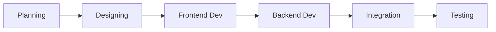

# PRD — Project Requirements Document


## 1. Overview
### 1.1 Latar Belakang
### 1.2 Tujuan Produk
### 1.3 Ruang Lingkup

## 2. Requirements
### 2.1 Functional Requirements
### 2.2 Non-Functional Requirements
### 2.3 Business Requirements

## 3. Core Features

## 4. User Flow

## 5. Architecture

## 6. Database Schema

### 6.1 Entity Relationship Diagram


### 6.2 Tabel Utama

### 6.3 Chroma Vector Collection

### 6.4 Drizzle ORM Schema Structure

### 6.5 Migration Commands

```bash
npx drizzle-kit generate    # Generate migration dari perubahan schema
npx drizzle-kit migrate     # Terapkan migration ke database
npx drizzle-kit studio      # Visual database browser
```

## 7. Tech Stack

### 7.1 Core Technologies

| Layer | Teknologi | Fungsi |
|---|---|---|
| **Framework** | Next.js 16 (App Router) | Full-stack web framework dengan SSR, API routes, middleware |
| **Language** | TypeScript | Type safety dan developer experience |
| **Styling** | Tailwind CSS v4 | Utility-first CSS framework |
| **UI Components** | Shadcn/UI | Accessible, customizable component library |
| **State Management** | Zustand | Lightweight client-side state |
| **ORM** | Drizzle ORM | Type-safe SQL queries dan migration support |
| **Database** | PostgreSQL 17 | Database relasional utama |
| **Vector DB** | Chroma | Purpose-built untuk vector similarity search |
| **Embedding** | intfloat/multilingual-e5-small | Model embedding multilingual (384 dimensi) |
| **Embedding Host** | HF Text Embeddings Inference | High-performance embedding server |
| **LLM** | Llama 3.2:1b via Ollama | Local, privacy-focused language model |
| **Auth** | Better Auth | Autentikasi modern dengan role-based access |
| **Containerization** | Docker Compose | Orkestrasi multi-service |

### 7.2 Docker Services

### 7.3 API Endpoints


## 8. Design Guidelines

### 8.1 Prinsip Desain

- **Modern & Premium**: Desain yang terasa modern, bersih, dan profesional
- **Mobile-First**: Responsif untuk semua ukuran layar, dioptimasi untuk iPad
- **Aksesibilitas**: Menggunakan Shadcn/UI yang built-in accessible
- **Konsistensi**: Semua komponen mengikuti design system yang sama

### 8.2 UI Component Library

Semua UI menggunakan **Shadcn/UI** sebagai base, di-style dengan **Tailwind CSS v4**. Shadcn dipilih karena source code dimiliki langsung (bukan dependency), memudahkan kustomisasi.

**Komponen Utama:**
- `Button`, `Input`, `Textarea`, `Label` — Forms
- `Card`, `Badge`, `Avatar` — Menu items, order cards
- `Tabs`, `Dialog`, `Sheet` — Navigasi, modal
- `Toast`, `Alert` — Notifikasi
- `Table`, `DropdownMenu` — Admin views
- `Skeleton` — Loading states
- `ScrollArea` — Chat messages

### 8.3 Palet Warna

- **Warna Primer (Hijau):** Digunakan untuk elemen utama seperti tombol aksi, header, dan highlight untuk mencerminkan nuansa kafe yang segar dan natural.

- **Warna Aksen (Oranye/Kuning):** Digunakan untuk badge "Popular", notifikasi, dan elemen yang memerlukan perhatian khusus untuk memberikan kesan hangat dan menarik.

- **Warna Status:**
  - 🟢 Hijau — Completed / Success
  - 🟡 Kuning — Preparing / Warning (> 10 menit)
  - 🔴 Merah — Urgent / Error (> 20 menit)
  - 🔵 Biru — New / Info

- **Warna Netral:** Putih & Abu-abu — Digunakan untuk latar belakang konten, teks, dan elemen sekunder agar tampilan tetap bersih dan tidak terlalu ramai, sehingga fokus pengguna tetap pada jadwal dan tombol aksi.

### 8.4 Tipografi

- **Font Family**: Inter (Google Fonts) — Modern, clean, highly readable
- **Heading**: Bold / Semi-bold
- **Body**: Regular / Medium
- **Bahasa**: Konten utama dalam Bahasa Indonesia

### 8.5 Layout Halaman


## 9. Development Process Flow

Untuk memastikan pengembangan berjalan terstruktur dan tepat waktu, berikut adalah alur proses pengembangan perangkat lunak yang akan diikuti:



- **Planning:** Tahap awal untuk menentukan kebutuhan bisnis, ruang lingkup fitur, dan sumber daya yang diperlukan agar proyek memiliki arah yang jelas.

- **Designing:** Proses pembuatan wireframe, prototipe UI/UX, serta perancangan skema database dan arsitektur sistem sebelum kode ditulis.

- **Frontend Dev:** Pengembangan bagian antarmuka pengguna yang akan dilihat oleh pelanggan dan admin menggunakan Next.js dan Tailwind CSS.

- **Backend Dev:** Pengembangan logika server, API endpoint, integrasi database, dan sistem autentikasi untuk memastikan fungsi aplikasi berjalan benar.

- **Integration:** Tahap penggabungan kode frontend dan backend serta memastikan komunikasi antara klien dan server berjalan lancar tanpa error.

- **Testing:** Pengujian menyeluruh meliputi uji fungsionalitas, keamanan, performa, dan penggunaannya secara langsung sebelum aplikasi dirilis ke publik.

### 9.1 Risks & Mitigations


### 9.2 Seed Script Flow
