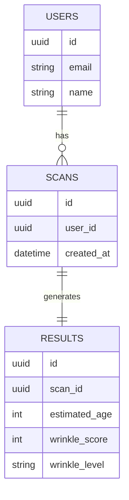
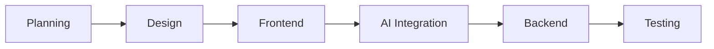

# PRD — Project Requirements Document

---

## 1. Overview

### 1.1 Latar Belakang

Perkembangan teknologi computer vision memungkinkan analisis wajah secara real-time langsung melalui browser tanpa perlu perangkat khusus. Di industri kecantikan dan kesehatan kulit, kebutuhan untuk mengetahui kondisi kulit seperti usia biologis dan tingkat kerutan semakin meningkat.

Saat ini, sebagian besar solusi masih memerlukan aplikasi khusus atau perangkat mahal. Oleh karena itu, diperlukan solusi berbasis web yang ringan, cepat, dan menjaga privasi pengguna.

---

### 1.2 Tujuan Produk

* Menyediakan analisis wajah berbasis web secara real-time
* Mengestimasi usia pengguna berdasarkan fitur wajah
* Mendeteksi dan mengukur tingkat kerutan wajah
* Memberikan insight sederhana terkait kondisi kulit
* Menjaga privasi dengan pemrosesan lokal (client-side)

---

### 1.3 Ruang Lingkup

**Termasuk:**

* Face detection (kamera & upload)
* Age estimation
* Wrinkle detection (basic scoring)
* UI dashboard hasil analisis

**Tidak termasuk (fase awal):**

* Diagnosa medis
* Penyimpanan data jangka panjang
* Integrasi klinik atau dokter

---

## 2. Requirements

### 2.1 Functional Requirements

* User dapat membuka kamera melalui browser
* User dapat upload foto wajah
* Sistem mendeteksi wajah secara otomatis
* Sistem menampilkan estimasi usia
* Sistem menghitung tingkat kerutan
* Sistem menampilkan hasil dalam UI
* Sistem memberikan basic recommendation

---

### 2.2 Non-Functional Requirements

* Response time < 3 detik
* Real-time processing minimal 15 FPS
* Responsif di mobile & desktop
* Tidak menyimpan gambar tanpa consent
* Akurasi:

  * Age estimation ±5 tahun
  * Wrinkle detection ≥80%

---

### 2.3 Business Requirements

* Low cost infrastructure (client-side first)
* Scalability untuk integrasi future B2B (beauty clinic)
* White-label ready untuk brand kosmetik
* Privacy compliance (no image storage by default)

---

## 3. Core Features

* Face Detection & Landmark Tracking
* Real-time Age Estimation
* Wrinkle Detection & Scoring
* Visual Overlay (bounding box & landmarks)
* Result Panel (age, wrinkle level, recommendation)
* Camera & Image Upload Mode

---

## 4. User Flow

1. User membuka web app
2. User grant akses kamera / upload foto
3. Sistem mendeteksi wajah
4. Sistem melakukan analisis (age + wrinkle)
5. Hasil ditampilkan secara real-time
6. User dapat ulang scan

---

## 5. Architecture

**Client-First Architecture (MVP):**

```
Browser (Next.js)
 ├── Camera (WebRTC)
 ├── AI Inference (TensorFlow.js / Face-api.js)
 └── UI Rendering (Canvas)
```

**Hybrid (Future):**

```
Client (Next.js)
   ↓
API Layer (Node.js / FastAPI)
   ↓
AI Service (PyTorch / ONNX)
   ↓
Database + Storage
```

---

## 6. Database Schema

### 6.1 Entity Relationship Diagram



---

### 6.2 Tabel Utama

**users**

* id (uuid)
* email
* name

**scans**

* id (uuid)
* user_id (optional)
* created_at

**results**

* id (uuid)
* scan_id
* estimated_age
* wrinkle_score (0–100)
* wrinkle_level (low, medium, high)

---

### 6.3 Chroma Vector Collection

Digunakan untuk future enhancement seperti:

* Similar face pattern analysis
* Skin condition clustering

**Collection:**

* `face_embeddings`

  * id
  * embedding (vector 384 dim)
  * metadata (age, wrinkle_score)

---

### 6.4 Drizzle ORM Schema Structure

```ts id="d3h9k1"
export const users = pgTable("users", {
  id: uuid("id").primaryKey(),
  email: text("email"),
  name: text("name"),
});

export const scans = pgTable("scans", {
  id: uuid("id").primaryKey(),
  userId: uuid("user_id"),
  createdAt: timestamp("created_at"),
});

export const results = pgTable("results", {
  id: uuid("id").primaryKey(),
  scanId: uuid("scan_id"),
  estimatedAge: integer("estimated_age"),
  wrinkleScore: integer("wrinkle_score"),
  wrinkleLevel: text("wrinkle_level"),
});
```

---

### 6.5 Migration Commands

```bash
npx drizzle-kit generate
npx drizzle-kit migrate
npx drizzle-kit studio
```

---

## 7. Tech Stack

### 7.1 Core Technologies

| Layer                  | Teknologi            | Fungsi                   |
| ---------------------- | -------------------- | ------------------------ |
| **Framework**          | Next.js (App Router) | Full-stack web framework |
| **Language**           | TypeScript           | Type safety              |
| **Styling**            | Tailwind CSS         | UI styling               |
| **UI Components**      | Shadcn/UI            | Component system         |
| **State Management**   | Zustand              | Client state             |
| **AI (Client)**        | TensorFlow.js        | In-browser ML inference  |
| **Face Detection**     | Face-api.js          | Face + landmark + age    |
| **Backend (Optional)** | FastAPI / Node.js    | API layer                |
| **ORM**                | Drizzle ORM          | DB access                |
| **Database**           | PostgreSQL           | Data storage             |
| **Vector DB**          | Chroma               | Embedding storage        |
| **Containerization**   | Docker               | Deployment               |

---

### 7.2 Docker Services

* frontend (Next.js)
* backend (API)
* postgres
* chroma
* nginx

---

### 7.3 API Endpoints

**POST /scan**

* input: image
* output: age, wrinkle_score

**GET /result/:id**

* get scan result

**POST /auth/login**

* user authentication

---

## 8. Design Guidelines

### 8.1 Prinsip Desain

* Modern & clean
* Mobile-first
* Fast & responsive
* Minimal interaction (1-click scan)

---

### 8.2 UI Component Library

Menggunakan Shadcn/UI + Tailwind:

* Camera preview
* Scan button
* Result card
* Notification toast

---

### 8.3 Palet Warna

* Primary: Hijau (health/skin)
* Accent: Oranye (highlight)
* Neutral: Putih & abu

---

### 8.4 Tipografi

* Font: Inter
* Clean & readable
* Bahasa Indonesia

---

### 8.5 Layout Halaman

* Landing page
* Scan page (camera)
* Result panel
* Optional history page

---

## 9. Development Process Flow



---

### 9.1 Risks & Mitigations

| Risk              | Mitigation                             |
| ----------------- | -------------------------------------- |
| Akurasi AI rendah | Gunakan pretrained model + fine tuning |
| Lighting buruk    | Tambahkan user guidance                |
| Device low-end    | Optimize model (tiny model)            |
| Privacy concern   | Client-side processing                 |

---

### 9.2 Seed Script Flow

* Seed dummy users
* Seed sample scan results
* Optional embedding samples untuk testing vector search

---
